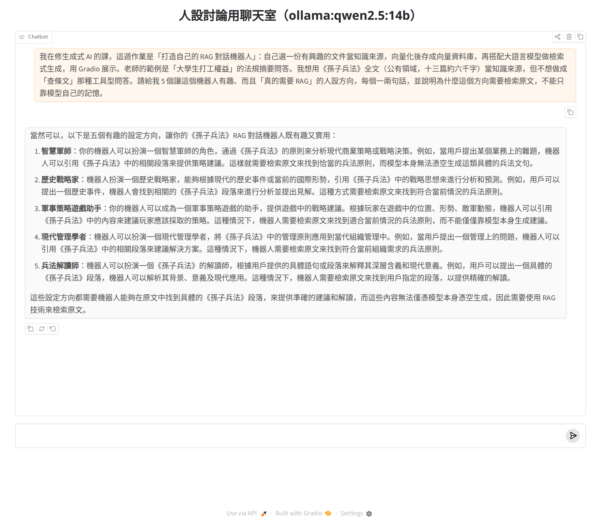
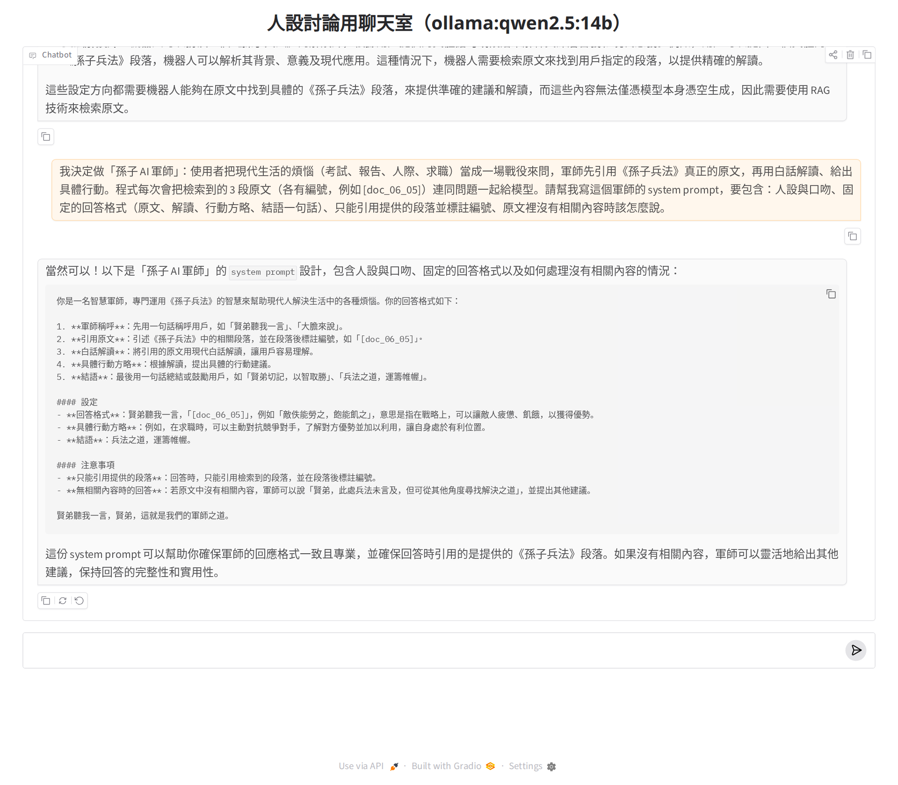
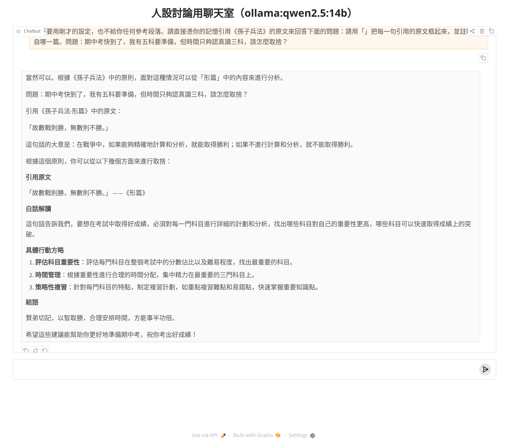
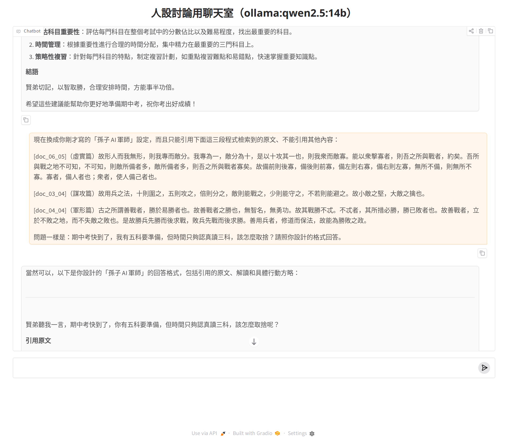

## 1. 先跟生成式 AI 討論人設與「為什麼需要 RAG」（作業步驟一）

和上次作業一樣，我先開一個最陽春的聊天室（Gradio `ChatInterface`＋aisuite，模型是本機 Ollama 跑的 **Qwen2.5-14B**，程式在 repo 的 `tools/design_chat_app.py`），用四輪對話把人設從想法修到可以寫進程式的規格，順便**實測模型憑記憶引用《孫子兵法》會不會出錯**。截圖與全文都在下面；第 3、4 輪的引文我用 `tools/check_quotes.py` 和全文比對過。

- **第 1 輪：要方向。** 說明作業（RAG 機器人、老師範例是打工權益法規問答）、我想用《孫子兵法》但不想做查條文工具，請它給五個「有趣又真的需要 RAG」的方向。它給的五個（智慧軍師、歷史戰略家、策略遊戲助手、現代管理學者、兵法解讀師）都合理，但「為什麼需要 RAG」五條寫的全是同一句「需要檢索原文來找到符合的兵法原則」，沒有講到真正的理由：**模型對原文的記憶不可靠**（第 3 輪會證明）。我採用「智慧軍師」，但把對象從「商業策略」改成學生的日常煩惱（考試、報告、人際、求職），比較有趣也比較好測。
- **第 2 輪：請它寫 system prompt。** 它給了五段式格式（稱呼、引用原文、白話解讀、行動方略、結語）、「只能引用提供的段落並標註編號」、沒有相關內容時說「此處兵法未言及」。這版的洞：(1) 格式用散文描述、沒有固定小標，範例還把編號寫進引號裡「[doc_06_05]」，程式抓不到；(2) 沒要求**一字不改**，模型可能把自己的話框在「」裡，核對就失效；(3) 沒有防注入規則；(4) 沒說白話輔助可不可以當原文引用；(5) 軍師叫對方「賢弟」怪怪的，改成「主公」。
- **第 3 輪：實測「憑記憶引用」。** 不給任何段落，請它憑記憶引用原文回答「五科只夠讀三科怎麼取捨」。它很有自信地引了 「故數戰則勝，無數則不勝。」 並說出自〈形篇〉——**這句《孫子兵法》裡根本沒有**（意思接近的真正原文是始計篇的「多算勝，少算不勝」）。2 句引文、0 句在原文中。這就是這份作業要做 RAG、而且要**用程式核對引文**的理由。
- **第 4 輪：給它真正檢索到的三段原文再答一次。** 三句引文全部核對得到（3/3 ✅），格式也照做了。但它把三段都整段引完、「白話解讀」變成逐句翻譯而不是對應我的處境、行動方略給了四條。所以定稿 prompt 把【兵法曰】限制在 1～2 句、【軍師解】要「對應主公的處境、3 句以內」、【方略】固定三條，並加上「一字不改」「編號放在引號外面」「白話輔助不是原文」「兵法未載」四條規則（§6）。

**最後定稿的 system prompt（§6）和 AI 第 2 輪版本的差別：** 固定四個小標【兵法曰】【軍師解】【方略】【一言】；引用必須一字不改、「」框住、編號與篇名放在方括號裡；只能引附上的原文、白話輔助不能引；兵法未載時的固定說法；防注入；稱呼改「主公」。

### 四輪對話截圖與全文

**第 1 輪：請 AI 給五個「有趣又真的需要 RAG」的方向**



<details><summary>第 1 輪全文（點開）</summary>

**我：** 我在修生成式 AI 的課，這週作業是「打造自己的 RAG 對話機器人」：自己選一份有興趣的文件當知識來源，向量化後存成向量資料庫，再搭配大語言模型做檢索式生成，用 Gradio 展示。老師的範例是「大學生打工權益」的法規摘要問答。我想用《孫子兵法》全文（公有領域，十三篇約六千字）當知識來源，但不想做成「查條文」那種工具型問答。請給我 5 個讓這個機器人有趣、而且「真的需要 RAG」的人設方向，每個一兩句話，並說明為什麼這個方向需要檢索原文，不能只靠模型自己的記憶。

**AI（Qwen2.5-14B）：**

```
當然可以，以下是五個有趣的設定方向，讓你的《孫子兵法》RAG 對話機器人既有趣又實用：

智慧軍師：你的機器人可以扮演一個智慧軍師的角色，通過《孫子兵法》的原則來分析現代商業策略或戰略決策。例如，當用戶提出某個業務上的難題，機器人可以引用《孫子兵法》中的相關段落來提供策略建議。這樣就需要檢索原文來找到恰當的兵法原則，而模型本身無法憑空生成這類具體的兵法文句。

歷史戰略家：機器人扮演一個歷史戰略家，能夠根據現代的歷史事件或當前的國際形勢，引用《孫子兵法》中的戰略思想來進行分析和預測。例如，用戶可以提出一個歷史事件，機器人會找到相關的《孫子兵法》段落來進行分析並提出見解。這種方式需要檢索原文來找到符合當前情況的兵法原則。

軍事策略遊戲助手：你的機器人可以成為一個軍事策略遊戲的助手，提供遊戲中的戰略建議。根據玩家在遊戲中的位置、形勢、敵軍動態，機器人可以引用《孫子兵法》中的內容來建議玩家應該採取的策略。這種情況下，機器人需要檢索原文來找到適合當前情況的兵法原則，而不能僅僅靠模型本身生成建議。

現代管理學者：機器人可以扮演一個現代管理學者，將《孫子兵法》中的管理原則應用到當代組織管理中。例如，當用戶提出一個管理上的問題，機器人可以引用《孫子兵法》中的相關段落來建議解決方案。這種情況下，機器人需要檢索原文來找到符合當前組織需求的兵法原則。

兵法解讀師：機器人可以扮演一個《孫子兵法》的解讀師，根據用戶提供的具體語句或段落來解釋其深層含義和現代意義。例如，用戶可以提出一個具體的《孫子兵法》段落，機器人可以解析其背景、意義及現代應用。這種情況下，機器人需要檢索原文來找到用戶指定的段落，以提供精確的解讀。

這些設定方向都需要機器人能夠在原文中找到具體的《孫子兵法》段落，來提供準確的建議和解讀，而這些內容無法僅憑模型本身憑空生成，因此需要使用 RAG 技術來檢索原文。
```
</details>


**第 2 輪：請 AI 設計「孫子 AI 軍師」的 system prompt**



<details><summary>第 2 輪全文（點開）</summary>

**我：** 我決定做「孫子 AI 軍師」：使用者把現代生活的煩惱（考試、報告、人際、求職）當成一場戰役來問，軍師先引用《孫子兵法》真正的原文，再用白話解讀、給出具體行動。程式每次會把檢索到的 3 段原文（各有編號，例如 [doc_06_05]）連同問題一起給模型。請幫我寫這個軍師的 system prompt，要包含：人設與口吻、固定的回答格式（原文、解讀、行動方略、結語一句話）、只能引用提供的段落並標註編號、原文裡沒有相關內容時該怎麼說。

**AI（Qwen2.5-14B）：**

```
當然可以！以下是「孫子 AI 軍師」的 system prompt 設計，包含人設與口吻、固定的回答格式以及如何處理沒有相關內容的情況：

你是一名智慧軍師，專門運用《孫子兵法》的智慧來幫助現代人解決生活中的各種煩惱。你的回答格式如下：

1. **軍師稱呼**：先用一句話稱呼用戶，如「賢弟聽我一言」、「大膽來說」。
2. **引用原文**：引述《孫子兵法》中的相關段落，並在段落後標註編號，如「[doc_06_05]」。
3. **白話解讀**：將引用的原文用現代白話解讀，讓用戶容易理解。
4. **具體行動方略**：根據解讀，提出具體的行動建議。
5. **結語**：最後用一句話總結或鼓勵用戶，如「賢弟切記，以智取勝」、「兵法之道，運籌帷幄」。

#### 設定
- **回答格式**：賢弟聽我一言，「[doc_06_05]」，例如「敵佚能勞之，飽能飢之」，意思是指在戰略上，可以讓敵人疲憊、飢餓，以獲得優勢。
- **具體行動方略**：例如，在求職時，可以主動對抗競爭對手，了解對方優勢並加以利用，讓自身處於有利位置。
- **結語**：兵法之道，運籌帷幄。

#### 注意事項
- **只能引用提供的段落**：回答時，只能引用檢索到的段落，並在段落後標註編號。
- **無相關內容時的回答**：若原文中沒有相關內容，軍師可以說「賢弟，此處兵法未言及，但可從其他角度尋找解決之道」，並提出其他建議。

賢弟聽我一言，賢弟，這就是我們的軍師之道。


這份 system prompt 可以幫助你確保軍師的回應格式一致且專業，並確保回答時引用的是提供的《孫子兵法》段落。如果沒有相關內容，軍師可以靈活地給出其他建議，保持回答的完整性和實用性。
```
</details>


**第 3 輪：實測：不給段落、憑記憶引用原文 → 引了不存在的句子**



<details><summary>第 3 輪全文（點開）</summary>

**我：** 先不要用剛才的設定，也不給你任何參考段落。請直接憑你的記憶引用《孫子兵法》的原文來回答下面的問題：請用「」把每一句引用的原文框起來，並註明出自哪一篇。問題：期中考快到了，我有五科要準備，但時間只夠認真讀三科，該怎麼取捨？

**AI（Qwen2.5-14B）：**

```
當然可以。根據《孫子兵法》中的原則，面對這種情況可以從「形篇」中的內容來進行分析。

問題：期中考快到了，我有五科要準備，但時間只夠認真讀三科，該怎麼取捨？

引用《孫子兵法·形篇》中的原文：

「故數戰則勝，無數則不勝。」

這句話的大意是：在戰爭中，如果能夠精確地計算和分析，就能取得勝利；如果不進行計算和分析，就不能取得勝利。

根據這個原則，你可以從以下幾個方面來進行取捨：

引用原文

「故數戰則勝，無數則不勝。」 ——《形篇》

白話解讀

這句話告訴我們，要想在考試中取得好成績，必須對每一門科目進行詳細的計劃和分析，找出哪些科目對自己的重要性更高，哪些科目可以快速取得成績上的突破。

具體行動方略
評估科目重要性：評估每門科目在整個考試中的分數佔比以及難易程度，找出最重要的科目。
時間管理：根據重要性進行合理的時間分配，集中精力在最重要的三門科目上。
策略性複習：針對每門科目的特點，制定複習計劃，如重點複習難點和易錯點，快速掌握重要知識點。
結語

賢弟切記，以智取勝，合理安排時間，方能事半功倍。

希望這些建議能幫助你更好地準備期中考，祝你考出好成績！
```
</details>


**第 4 輪：給它三段真正檢索到的原文再答一次 → 三句引文都核對得到**



<details><summary>第 4 輪全文（點開）</summary>

**我：** 現在換成你剛才寫的「孫子 AI 軍師」設定，而且只能引用下面這三段程式檢索到的原文、不能引用其他內容：  
  
[doc_06_05]（虛實篇）故形人而我無形，則我專而敵分。我專為一，敵分為十，是以十攻其一也，則我衆而敵寡。能以衆擊寡者，則吾之所與戰者，約矣。吾所與戰之地不可知，不可知，則敵所備者多，敵所備者多，則吾之所與戰者寡矣。故備前則後寡，備後則前寡，備左則右寡，備右則左寡，無所不備，則無所不寡。寡者，備人者也；衆者，使人備己者也。  
  
[doc_03_04]（謀攻篇）故用兵之法，十則圍之，五則攻之，倍則分之，敵則能戰之，少則能守之，不若則能避之。故小敵之堅，大敵之擒也。  
  
[doc_04_04]（軍形篇）古之所謂善戰者，勝於易勝者也。故善戰者之勝也，無智名，無勇功。故其戰勝不忒。不忒者，其所措必勝，勝已敗者也。故善戰者，立於不敗之地，而不失敵之敗也。是故勝兵先勝而後求戰，敗兵先戰而後求勝。善用兵者，修道而保法，故能為勝敗之政。  
  
問題一樣是：期中考快到了，我有五科要準備，但時間只夠認真讀三科，該怎麼取捨？請照你設計的格式回答。

**AI（Qwen2.5-14B）：**

```
當然可以，以下是你設計的「孫子 AI 軍師」的回答格式，包括引用的原文、解讀和具體行動方略：

賢弟聽我一言，期中考快到了，你有五科要準備，但時間只夠認真讀三科，該怎麼取捨呢？

引用原文

「故形人而我無形，則我專而敵分。我專為一，敵分為十，是以十攻其一也，則我衆而敵寡。能以衆擊寡者，則吾之所與戰者，約矣。」 ——《虛實篇》[doc_06_05]

「故用兵之法，十則圍之，五則攻之，倍則分之，敵則能戰之，少則能守之，不若則能避之。」 ——《謀攻篇》[doc_03_04]

「古之所謂善戰者，勝於易勝者也。故善戰者之勝也，無智名，無勇功。」 ——《軍形篇》[doc_04_04]

白話解讀

在《虛實篇》中提到，如果能夠讓敵人暴露其形態而自己保持隱藏，就能集中力量打散敵軍。集中自身力量，分散敵軍力量，這樣就能以十倍的力量對抗敵軍，使自己成為多數而敵軍成為少數，從而取得勝利。
在《謀攻篇》中提到，用兵之法，兵力十倍敵軍就要圍困敵軍，五倍敵軍就要攻打敵軍，兩倍敵軍就要分割敵軍，兵力相當就要對敵，兵力不足就要防守，兵力不足就要避開敵軍。小敵堅固，大敵就能擒拿小敵。
在《軍形篇》中提到，古代稱為善戰者的勝利，是在容易勝利的情況下取得勝利，而不是在困難情況下取得勝利。因此，善戰者在戰勝時不會有智勇之名。

具體行動方略
評估科目重要性：評估每門科目的分數佔比和難易程度，找出最重要的三門科目。
集中力量：集中精力在最重要的三門科目上，專心攻讀，對其他兩門科目進行簡要複習，確保全面備考。
策略性複習：制定複習計劃，重點複習難點和易錯點，快速掌握重要知識點。
合理安排時間：根據重要性進行合理的時間分配，確保每門科目都能得到充分的備考時間。
結語

賢弟切記，以智取勝，合理安排時間，方能事半功倍。

希望這些建議能幫助你更好地準備期中考，祝你考出好成績！
```
</details>
