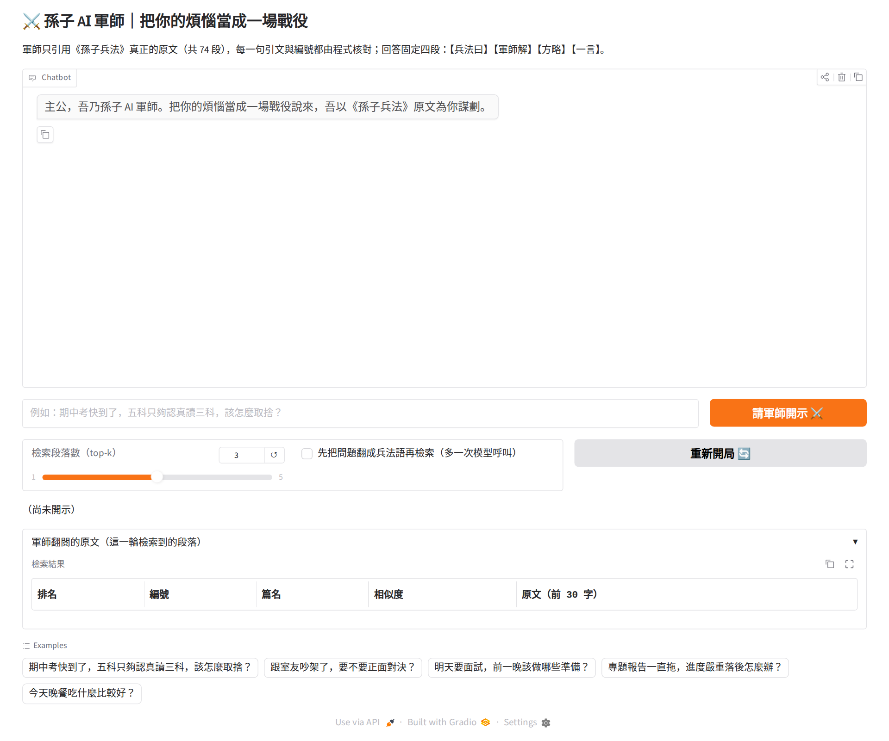
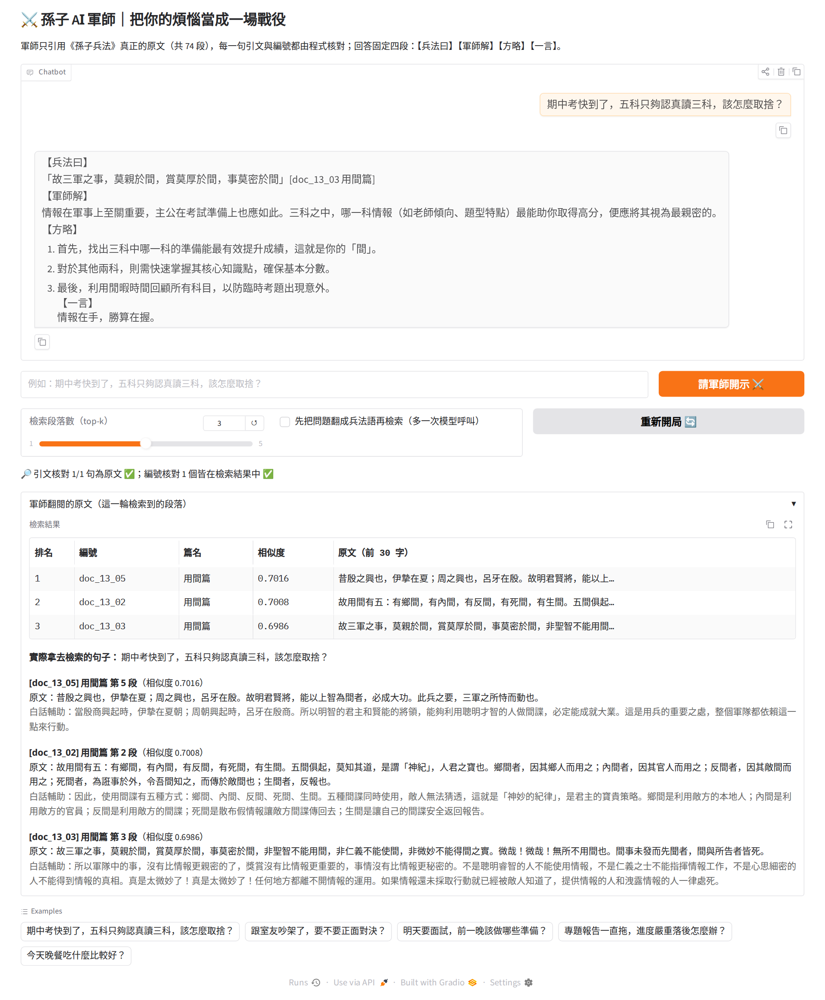
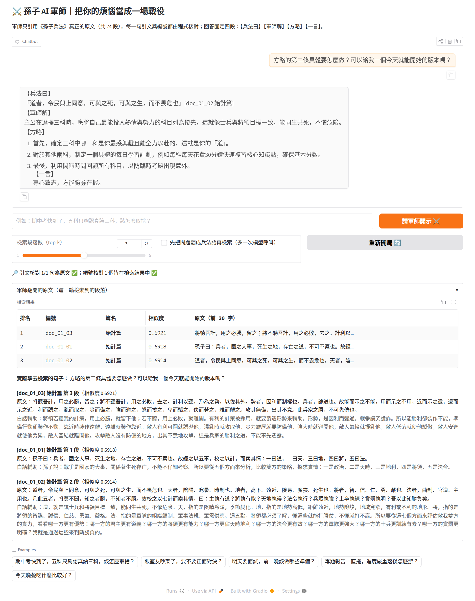
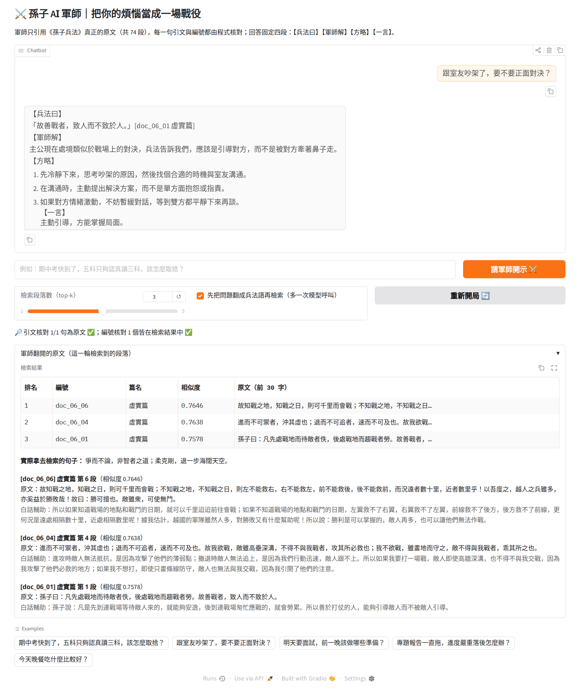
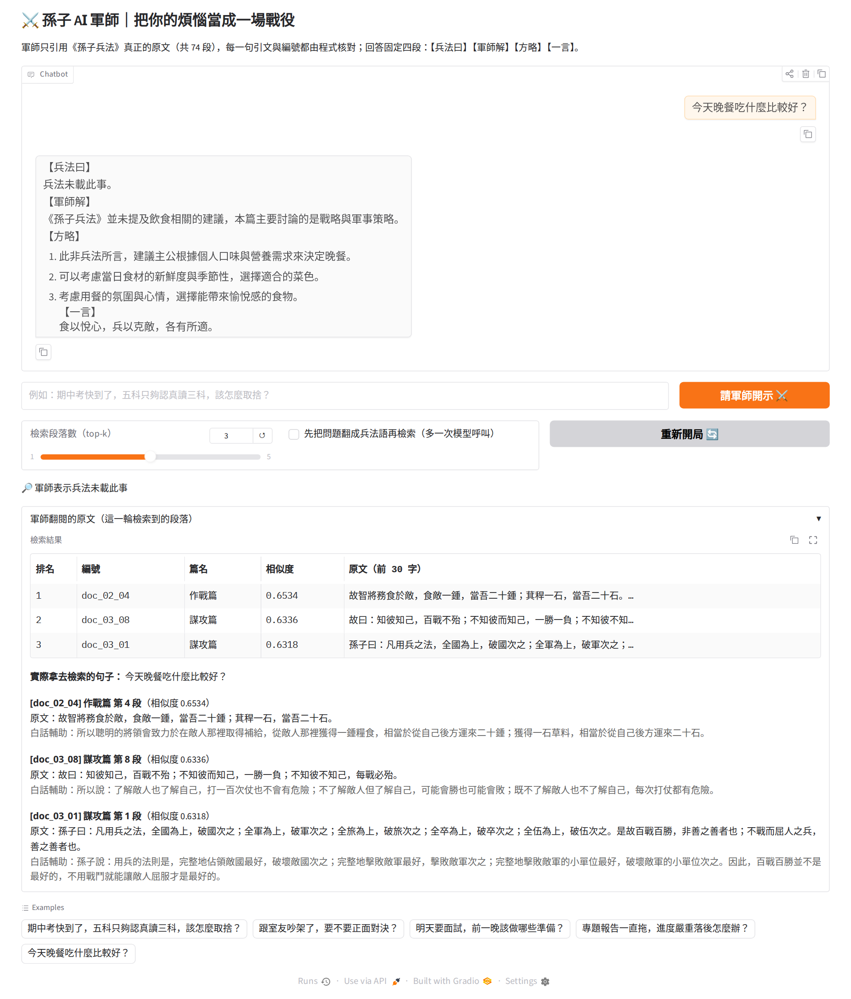

## 10. Gradio 對話結果（實際操作截圖）

截圖是在本機跑 `app.py`（和這本 notebook 同一份程式，模型 `ollama:qwen2.5:14b`）、用 Playwright 真的打字送出、按按鈕後擷取的；每一張對應的完整對話與核對結果在 repo 的 `screenshots/app_log.json`。流程：開局 → 問一題 → 追問 → 重新開局並打開「翻成兵法語再檢索」→ 再重新開局問一個兵法沒談到的問題。

**(1) 開局畫面。** 聊天區是軍師的開場白；下方是問題框、top-k 滑桿、改寫檢索開關、重新開局；再下面是「核對結果」一行與可收合的「軍師翻閱的原文」。

**(2) 問「期中考五科只夠讀三科怎麼取捨」。** 回答固定四段【兵法曰】【軍師解】【方略】【一言】；核對那一行顯示每句引文是否真的是原文、編號是否在這輪檢索到的段落裡；下方表格與原文區就是這一輪送給模型的三段。

> **主公：** 期中考快到了，五科只夠認真讀三科，該怎麼取捨？  
> **軍師：** 「故三軍之事，莫親於間，賞莫厚於間，事莫密於間」[doc_13_03 用間篇]  
> **核對：** 🔎 引文核對 1/1 句為原文 ✅；編號核對 1 個皆在檢索結果中 ✅

**(3) 追問「方略第二條具體怎麼做」。** 這一輪的檢索用的是追問句本身（所以找到的段落不一定相關），但軍師有對話歷史（`gr.State`），接著上一輪的方略往下講。

> **主公：** 方略的第二條具體要怎麼做？可以給我一個今天就能開始的版本嗎？  
> **軍師：** 「道者，令民與上同意，可與之死，可與之生，而不畏危也」[doc_01_02 始計篇]  
> **核對：** 🔎 引文核對 1/1 句為原文 ✅；編號核對 1 個皆在檢索結果中 ✅

**(4) 重新開局，打開「先把問題翻成兵法語再檢索」。** 模型先把「跟室友吵架要不要正面對決」翻成兵法風格的句子（原文區第一行會顯示實際拿去檢索的句子），再用那句去找段落：

> 實際拿去檢索的句子：

> **主公：** 跟室友吵架了，要不要正面對決？  
> **軍師：** 「故善戰者，致人而不致於人。」[doc_06_01 虛實篇]  
> **核對：** 🔎 引文核對 1/1 句為原文 ✅；編號核對 1 個皆在檢索結果中 ✅

**(5) 問「今天晚餐吃什麼」。** FAISS 照樣回傳三段最像的，但軍師應該回「兵法未載此事」而不是硬套：

> **主公：** 今天晚餐吃什麼比較好？  
> **軍師：** 兵法未載此事。  
> **核對：** 🔎 軍師表示兵法未載此事

